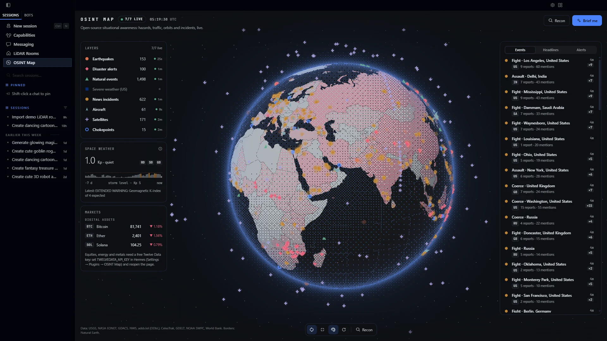
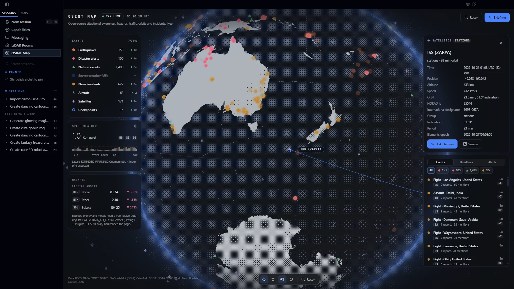
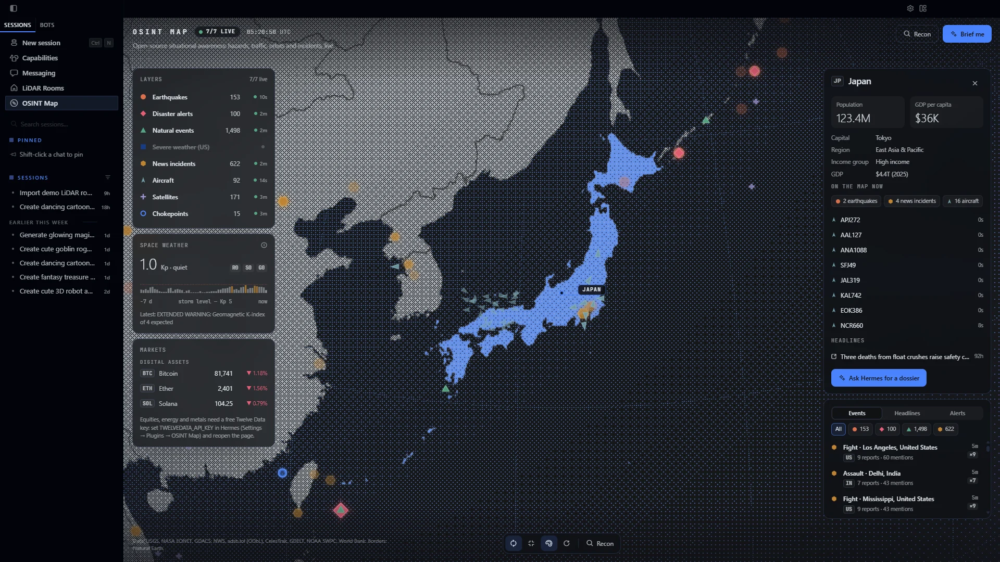
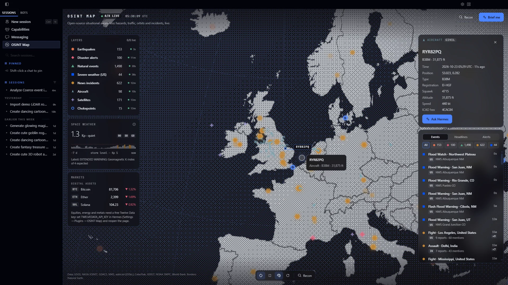
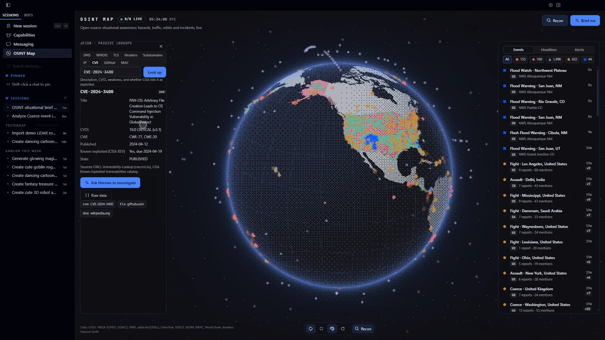

<div align="center">

  <a href="https://github.com/NousResearch/hermes-agent">
    
  </a>

  # Hermes OSINT Map

  **The world's live signals on one globe, and an agent that can brief you on them.**

  Earthquakes, disaster alerts, natural events, severe weather, aircraft, satellites, news-derived incidents, traffic cameras and shipping chokepoints on a dithered 3D globe inside Hermes Desktop.
  Country dossiers, a passive recon toolkit, and briefings Hermes writes from the same public sources.

  <sub>POWERED BY <a href="https://github.com/NousResearch/hermes-agent">HERMES AGENT</a> &nbsp;·&nbsp; COMMUNITY PLUGIN &nbsp;·&nbsp; VERSION 0.2.0</sub>

  <br /><br />

  [What it does](#one-globe-every-signal) &nbsp;·&nbsp; [Install it](#make-it-yours) &nbsp;·&nbsp; [Where your data goes](#privacy-you-can-explain-in-one-breath)

</div>


## Powered by Hermes

Hermes OSINT Map is a community plugin for [Hermes Agent](https://github.com/NousResearch/hermes-agent) with two halves in one package:

- **A Desktop page.** A full-screen globe, built on the [Desktop plugin SDK](https://github.com/NousResearch/hermes-agent/blob/main/website/docs/developer-guide/desktop-plugin-sdk.md), with a sidebar entry and palette commands.
- **Five agent tools.** They answer from the same sources in any chat: the CLI, Hermes Desktop, the messaging gateway, cron jobs and subagents.

Every source is public and needs no account. The page's "Brief me", "Ask Hermes" and dossier buttons open a chat with a structured request, and Hermes answers with these tools.



## One globe, every signal

| Layer | Shape | Source | Refresh |
| --- | --- | --- | --- |
| Earthquakes | ● circle | USGS (M2.5+ last day, M4.5+ last week) | 1 min |
| Disaster alerts | ◆ diamond | GDACS | 10 min |
| Natural events | ▲ triangle | NASA EONET (observed in the last 30 days) | 10 min |
| Severe weather (US) | ■ square | National Weather Service | 5 min |
| News incidents | ⬢ hexagon | GDELT events, last 3 hours | 15 min |
| Aircraft | ➤ dart | adsb.lol: military worldwide, all traffic near the view when zoomed in | 15 s |
| Satellites | ✚ plus | CelesTrak elements, positions computed live (SGP4) | 1 s |
| Traffic cameras | ▢ frame | Transport for London JamCams and Singapore LTA (data.gov.sg), official open data | stills every minute |
| Chokepoints | ○ ring | Curated straits and canals | static |

| | |
| --- | --- |
| **Follow what moves**<br />Click a satellite to draw its next orbit, an aircraft to see the track it flew while you watched, or a traffic camera for its latest still. | **Drill into a country**<br />A dossier with World Bank facts, everything on the map there, and recent headlines. |
| **Read the room**<br />NOAA space weather, markets, a layer-health panel, and a feed of events, world headlines and alerts. | **Look things up**<br />DNS, RDAP/WHOIS, TLS certificates, security headers, CT subdomains, CVEs with CISA KEV status, IP, GitHub and MAC lookups. |

| Satellite tracking | Country dossier |
| --- | --- |
|  |  |

| Aircraft | Recon |
| --- | --- |
|  |  |

### Tools for the agent

| Tool | Answers |
| --- | --- |
| `osint_situation` | what's happening right now across every layer, plus Kp and top headlines |
| `osint_events` | events by layer, country, or a point and radius |
| `osint_country` | a country's facts, current events and headlines |
| `osint_recon` | any recon lookup |
| `osint_news` | headline search |

## Small decisions, already made

- Layers never depend on colour alone: each has its own shape, and every colour comes from your Hermes theme.
- Older events fade into the background instead of vanishing, and new ones pulse once as they arrive.
- Each source is fetched once per refresh for every window and agent call, through a shared cache.
- A source that fails keeps serving its last good data, marked stale, and is left alone for a while before the next try.
- adsb.lol requests are spaced out and retried once after a rate limit.
- Headline search matches every word in any order.
- Traffic cameras come only from official open-data feeds. They cluster into one marker per city until you zoom in, and a camera's still is fetched by its id from the operator's own image host, never from an address the page supplies.
- Recon lookups that connect to a host refuse private, loopback, link-local and other internal addresses, before and after redirects.
- News incidents are machine-coded from news coverage. The page and the tools say so; they show where reporting is, not verified events.
- The page stops all polling and rendering when you leave it or the window is hidden. It respects reduced motion and works in split tiles.

## Make it yours

### Install

```sh
hermes plugins install Adolanium/hermes-osint-map
```

Then, in Hermes Desktop, open **Capabilities → Plugins → OSINT Map** and turn on both **Agent in Hermes** (the backend and tools) and **Desktop** (the page). Open **OSINT Map** from the sidebar or the ⌘K/Ctrl+K palette.

Hermes OSINT Map needs Hermes Agent 0.22.2 or later.

### Add markets (optional)

The markets panel shows crypto out of the box. Add a free [Twelve Data](https://twelvedata.com) key as `TWELVEDATA_API_KEY` in the plugin's settings to add defense stocks, energy, metals and the S&P 500. The plugin reads it only through Hermes's secret scope, so each profile keeps its own key.

### Keys

`1`–`9` toggle layers, `/` opens recon, `R` resets the view, `A` toggles spin, `D` toggles dithering, arrows rotate, `+`/`-` zoom, `Esc` closes a panel.

### Test

```sh
python -m pytest            # parsers, caches, recon guard, routes, tools (no network)
python scripts/smoke.py     # every route against the real sources
cd desktop-src && npm ci && npm test && npm run build
```

Check the plugin the same way the catalog does:

```sh
hermes plugins validate . --install-deps
```

## Privacy you can explain in one breath

```text
Hermes gateway  →  public data sources (fixed hosts, cached)  →  the globe, panels and tools
                →  recon: the one host or name you look up    →  the result card
```

- **What leaves your machine.** Requests to the public sources below, identified as `hermes-osint-map`. Recon lookups send the domain, IP, CVE, GitHub name or MAC prefix you enter to the matching public service. TLS and header lookups connect to the host you name.
- **Who it talks to.** USGS, NASA EONET, GDACS, the National Weather Service, GDELT, adsb.lol, CelesTrak, NOAA SWPC, Transport for London (api.tfl.gov.uk and its JamCams image bucket), data.gov.sg (Singapore traffic images), the World Bank, the BBC/Al Jazeera/DW/Guardian/France 24 RSS feeds, CoinGecko, and Twelve Data if you add a key. Recon uses Google Public DNS, rdap.org, crt.sh, CIRCL CVE, CISA KEV, ipwho.is, GitHub and MacVendors. Only the first three octets of a MAC address are sent.
- **Your key.** The optional Twelve Data key is sent to Twelve Data in a request header, never in a URL, and never logged or echoed in errors.
- **Nothing else.** No files written, no shell commands, no background processes, no telemetry. The page remembers your layer choices in Hermes Desktop's plugin storage.

## Compatibility

| Hermes Agent | Python | Status |
| --- | --- | --- |
| 0.22.5 | 3.14 | Tested by hand in Hermes Desktop (0.1.0) and in a browser preview of the page (0.2.0) |
| 0.22.2 (minimum) | 3.11+ | SDK surface checked |

The plugin depends only on `httpx` and `fastapi`, which Hermes already ships.

## Limits

- Aircraft come from volunteer ADS-B receivers: coverage is thin over oceans and some regions, and military traffic only shows when it broadcasts.
- Severe weather covers the United States only (NWS). Alerts without a mapped area are skipped.
- Traffic cameras cover London and Singapore for now. Both publish stills, not live video, refreshed every minute or so.
- GDELT incidents are machine-coded from news. Locations are often a city or country centroid, and labels like "Fight" describe the coverage, not a verified event.
- crt.sh, behind subdomain lookups, is often slow or down. Those lookups then fail with a clear error.
- Without a Twelve Data key, the markets panel shows crypto only.

## Data and credits

Earthquakes: USGS (public domain). Natural events: NASA EONET (public domain). Disaster alerts: GDACS. Severe weather: National Weather Service (public domain). Incidents: The GDELT Project. Aircraft: adsb.lol (ODbL). Satellites: CelesTrak. Traffic cameras: Powered by TfL Open Data (contains OS data © Crown copyright and database rights); Singapore traffic images from data.gov.sg under the Singapore Open Data Licence v1.0. Space weather: NOAA SWPC (public domain). Country facts: World Bank (CC BY 4.0). Headlines: links and titles from public RSS feeds. Borders: Natural Earth (public domain). Rendering: three.js (MIT); orbits: satellite.js (MIT).

<br />

<div align="center">
  <strong>Hermes OSINT Map</strong><br />
  <sub>See the world move. Ask Hermes what it means.</sub>
</div>

<br />

## License

[MIT](LICENSE).

> **Community project**
>
> Hermes OSINT Map is an independent community plugin. It is not affiliated with, endorsed by, sponsored by, or officially associated with [Nous Research](https://github.com/NousResearch), the [Hermes Agent project](https://github.com/NousResearch/hermes-agent), or any of the data providers listed above. Hermes, Hermes Agent and Nous Research are names and marks belonging to their respective owners.
