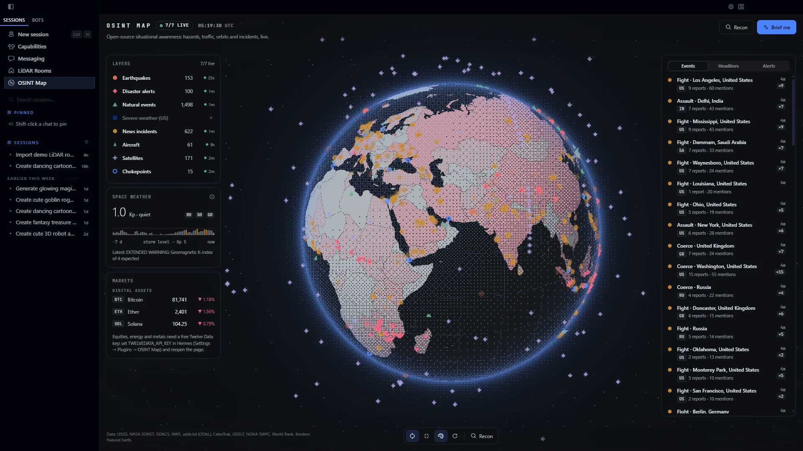
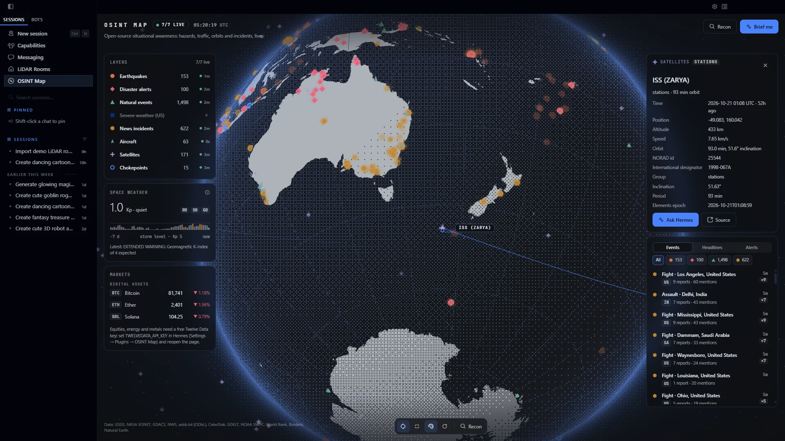
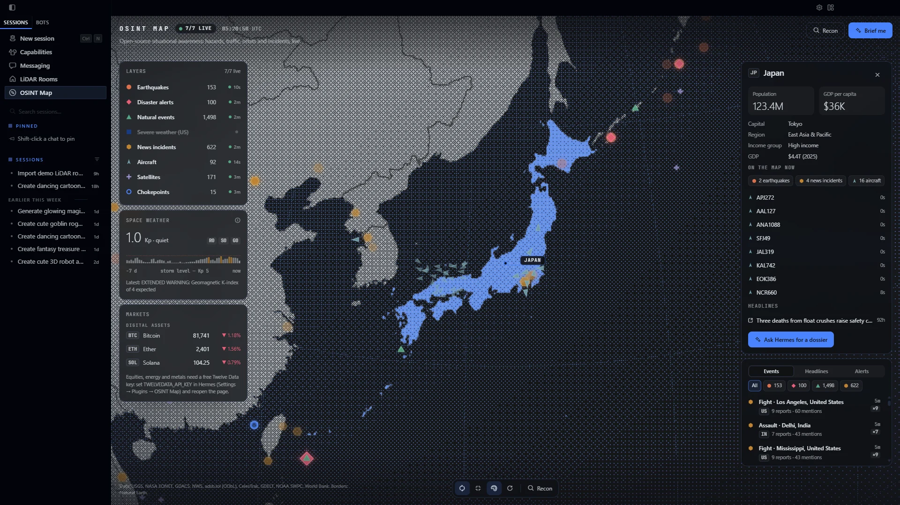
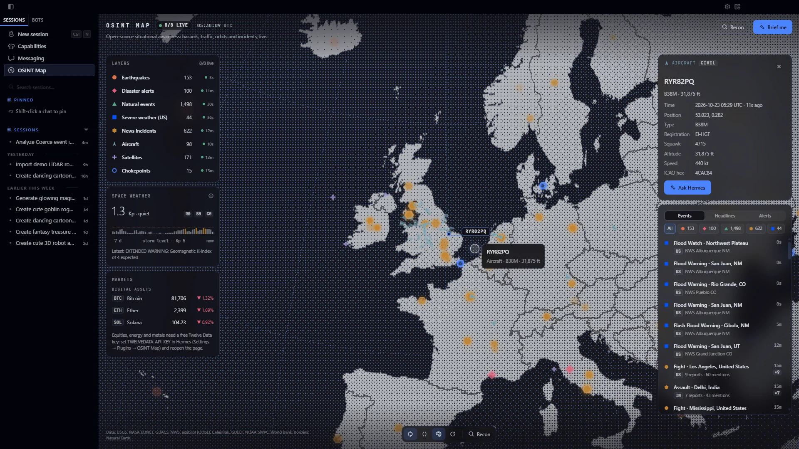
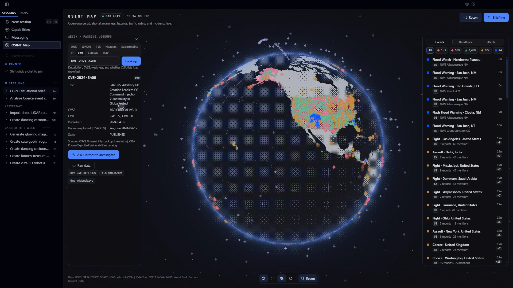

<div align="center">

  <a href="https://github.com/NousResearch/hermes-agent">
    
  </a>

  # Hermes OSINT Map

  **The world's live signals on one globe, and an agent that can brief you on them.**

  Earthquakes, disaster alerts, natural events, severe weather, aircraft, satellites, news-derived incidents, traffic cameras and shipping chokepoints on a dithered 3D globe inside Hermes Desktop.
  Country dossiers, a passive recon toolkit, briefings Hermes writes from the same public sources, live map cards in chat, and watches that tell you when something new happens in an area.

  <sub>POWERED BY <a href="https://github.com/NousResearch/hermes-agent">HERMES AGENT</a> &nbsp;·&nbsp; COMMUNITY PLUGIN &nbsp;·&nbsp; VERSION 0.4.0</sub>

  <br /><br />

  [What it does](#one-globe-every-signal) &nbsp;·&nbsp; [Watches](#watch-an-area) &nbsp;·&nbsp; [Install it](#make-it-yours) &nbsp;·&nbsp; [Where your data goes](#privacy-you-can-explain-in-one-breath)

</div>


## Powered by Hermes

Hermes OSINT Map is a community plugin for [Hermes Agent](https://github.com/NousResearch/hermes-agent) with two halves in one package:

- **A Desktop page.** A full-screen globe, built on the [Desktop plugin SDK](https://github.com/NousResearch/hermes-agent/blob/main/website/docs/developer-guide/desktop-plugin-sdk.md), with a sidebar entry and palette commands.
- **Seven agent tools.** They answer from the same sources in any chat: the CLI, Hermes Desktop, the messaging gateway, cron jobs and subagents.

Every source is public and needs no account. The page's "Brief me", "Ask Hermes" and dossier buttons open a chat with a structured request, and Hermes answers with these tools.



## One globe, every signal

| Layer | Shape | Source | Refresh |
| --- | --- | --- | --- |
| Earthquakes | ● circle | USGS (M2.5+ last day, M4.5+ last week) | 1 min |
| Disaster alerts | ◆ diamond | GDACS | 10 min |
| Natural events | ▲ triangle | NASA EONET (observed in the last 30 days) | 10 min |
| Severe weather (US) | ■ square | National Weather Service | 5 min |
| News incidents | ⬢ hexagon | GDELT events, last 3 hours | 15 min |
| Aircraft | ➤ dart | adsb.lol: military worldwide, all traffic near the view when zoomed in | 15 s |
| Satellites | ✚ plus | CelesTrak elements, positions computed live (SGP4) | 1 s |
| Traffic cameras | ▢ frame | About 5,000 official open-data cameras: Transport for London JamCams (live video clips), Caltrans (California highways), Hong Kong Transport Department, Singapore LTA (data.gov.sg) | London: a new 10 s video clip every few minutes; elsewhere stills every 1–2 minutes |
| Chokepoints | ○ ring | Curated straits and canals | static |
| Your own feeds (off by default) | ★ star | The RSS/Atom feeds and JSON digest files you name in the plugin's `feeds` setting | per source, 10 min by default |
| Cyber attacks (opt-in) | arcs: ◆ exploit, ● malware, ▲ phishing | Check Point ThreatCloud live map feed (unofficial) | live |

| | |
| --- | --- |
| **Watch attacks fly**<br />Turn on Cyber attacks and live detections from Check Point's public threat map arc from source to target, with the rate, today's total and the latest attacks in the rail. | **Pin it to chat**<br />Answers about a place end with a live map card you can open or watch. |
| **Follow what moves**<br />Click a satellite to draw its next orbit, an aircraft to see the track it flew while you watched, or one of about 5,000 traffic cameras in London, California, Hong Kong and Singapore for its latest still. | **Drill into a country**<br />A dossier with World Bank facts, everything on the map there, and recent headlines. |
| **Read the room**<br />NOAA space weather, markets, a layer-health panel, and a feed of events, world headlines and alerts. | **Look things up**<br />DNS, RDAP/WHOIS, TLS certificates, security headers, CT subdomains, CVEs with CISA KEV status, IP, GitHub and MAC lookups. |

| Satellite tracking | Country dossier |
| --- | --- |
|  |  |

| Aircraft | Recon |
| --- | --- |
|  |  |

### Tools for the agent

| Tool | Answers |
| --- | --- |
| `osint_situation` | what's happening right now across every layer, plus Kp and top headlines |
| `osint_events` | events by layer, country, or a point and radius |
| `osint_country` | a country's facts, current events and headlines |
| `osint_recon` | any recon lookup |
| `osint_news` | headline search |
| `osint_watch` | one check of a watched area: new events since the last check, or `NO_NEW_ITEMS` |
| `osint_show` | puts a scene on the Desktop globe while Hermes answers: a focus, labelled pins, a ring, layers and a vision mode |

When a query is given, `osint_news` also calls the GDELT 2.0 article-search API (`api.gdeltproject.org/api/v2/doc/doc`, no key, 10-minute cache) so local and specialist stories appear, not just the five world services.

### Hermes steers the globe

Ask for a brief, a region or "show me the Red Sea", and Hermes moves the map while it answers. It calls `osint_show`: the globe flies there, drops labelled pins on the places it mentions, rings an area, switches on the layers that matter, and shows its caption at the bottom. Each new part of the answer can move the map again. Close the caption to clear its marks.

### Tour, camera wall and vision modes

- **Tour** (`T`) flies through what matters right now: the strongest quake of the last day, the worst disaster alert, a natural event, the most-attacked country, a live traffic camera and the ISS, with a caption and a progress bar at each stop. Every stop comes from the live layers.
- **Camera wall.** Click a city's camera cluster and its nine nearest working cameras open as a live grid, each still refreshing every minute. Full screen turns the grid into a control-room view.
- **Big camera view.** Click any wall tile, or **Expand** on a camera's panel, to open its still (in London, its video clip) large with when it was taken and a countdown to the next one. `←` and `→` step to the next nearest camera (skipping ones that are off), and **Show on map** flies there.
- **Day and night** (`N`) shades the globe from the real sun position.
- **Vision** (`V`) cycles night vision, thermal and CRT. Each remaps the globe's colours and adds an overlay.
- Cyber attacks warm the countries they land in, and significant recent earthquakes keep rippling.

### Map cards in chat

When Hermes answers about a place in Hermes Desktop, the answer ends with a live map card: a small dithered globe of that area with its events marked, the four most recent ones listed with distance and age, and two buttons. **Open in OSINT Map** flies the big globe there. **Watch this area** starts a watch.

The card is a transcript directive (`::osint-map{lat="23.7" lon="121.0" radius="300"}` or `::osint-map{country="JP"}`). The plugin validates its attributes and fetches the data itself, so the model never writes the numbers you see. Tool answers ask for the card only in Hermes Desktop; the CLI and messaging platforms get plain text.

### Watch an area

Pick a spot on the globe, an event or a country and choose **Watch**. You set the radius, what counts (earthquakes from M4.5, M5 or M6, orange or red disaster alerts, natural events, severe weather, military aircraft, news incidents), how often to check, and where alerts go: Hermes only, or Telegram, Discord, Slack, WhatsApp, Signal, email or every connected channel.

A watch is a normal Hermes scheduled job, named `OSINT watch · <name>`, so it keeps running with the page closed and shows up in Scheduled jobs too. Each run calls `osint_watch` once:

- The first check records what is already in the area and says nothing.
- Later checks report only events that pass your rules and weren't seen before.
- When nothing is new, the job replies `[SILENT]` and Hermes delivers nothing.

The Watches card on the page lists every watch with its last check and latest alert, and pauses, resumes or removes it. You can also ask for one in any chat ("watch Taiwan for M5+ quakes and tell me on Telegram"); Hermes creates the same kind of job with its cron tool.

## Small decisions, already made

- Layers never depend on colour alone: each has its own shape, and every colour comes from your Hermes theme.
- Older events fade into the background instead of vanishing, and new ones pulse once as they arrive.
- Each source is fetched once per refresh for every window and agent call, through a shared cache.
- A source that fails keeps serving its last good data, marked stale, and is left alone for a while before the next try.
- adsb.lol requests are spaced out and retried once after a rate limit.
- Headline search matches every word in any order.
- Your own feeds are drawn coarsely on purpose: an item sits at the chokepoint it names, else at its country's label point (marked approximate), and an item that names neither is dropped and counted rather than guessed. The plugin contacts only the hosts you list.
- Traffic cameras come only from official open-data feeds. They cluster into one marker per city until you zoom in, and a camera's still is fetched by its id from the operator's own image host, never from an address the page supplies.
- Recon lookups that connect to a host refuse private, loopback, link-local and other internal addresses, before and after redirects.
- News incidents are machine-coded from news coverage. The page and the tools say so; they show where reporting is, not verified events. Their titles come from the source article's URL slug when one is readable, and fall back to the place name when it is not.
- The page stops all polling and rendering when you leave it or the window is hidden. It respects reduced motion and works in split tiles.

## Make it yours

### Install

```sh
hermes plugins install Adolanium/hermes-osint-map
```

Then, in Hermes Desktop, open **Capabilities → Plugins → OSINT Map** and turn on both **Agent in Hermes** (the backend and tools) and **Desktop** (the page). Open **OSINT Map** from the sidebar or the ⌘K/Ctrl+K palette.

Hermes OSINT Map needs Hermes Agent 0.22.2 or later.

### Add markets (optional)

The markets panel shows crypto out of the box. Add a free [Twelve Data](https://twelvedata.com) key as `TWELVEDATA_API_KEY` in the plugin's settings to add defense stocks, energy, metals and the S&P 500. The plugin reads it only through Hermes's secret scope, so each profile keeps its own key.

### Add your own feeds (optional)

The **Your own feeds** layer draws sources that are yours, not this plugin's, and stays off until you name one in the plugin's `feeds` setting (Settings → Plugins → OSINT Map):

```json
[{"url": "https://example.com/world.xml", "label": "Example world"},
 {"file": "/Users/me/.hermes/state/digest.json", "label": "Morning digest", "country": "US"}]
```

An entry takes a `url` (RSS 2.0, RSS 1.0 or Atom — the same reader as the headlines panel) or a `file` (a JSON digest), plus an optional `label`, a fallback `country` (ISO alpha-2) and `ttl` in seconds. A digest file is any JSON object with an `items` list, so a scheduled job or a mail rule can write one without knowing anything about this plugin:

```json
{"version": 1, "items": [{"title": "…", "url": "https://…", "summary": "…",
                          "country": "SA", "severity": 0.7, "time": "2026-11-09T16:17:53Z"}]}
```

Placement is coarse by design: the item's `place` (a chokepoint this plugin already knows) or a chokepoint named in its text, else its `country` — drawn at that country's label point and marked approximate. `lat`/`lon` are used verbatim when an item carries them. Anything else is dropped and counted in `dropped`, never guessed.

### Keys

`1`–`9` toggle layers, `C` toggles cyber attacks, `T` starts the tour, `N` toggles day and night, `V` cycles vision modes, `/` opens recon, `R` resets the view, `A` toggles spin, `D` toggles dithering, arrows rotate, `+`/`-` zoom, `Esc` closes a panel.

### Test

```sh
python -m pytest            # parsers, caches, recon guard, routes, tools (no network)
python scripts/smoke.py     # every route against the real sources
cd desktop-src && npm ci && npm test && npm run build
```

Check the plugin the same way the catalog does:

```sh
hermes plugins validate . --install-deps
```

## Privacy you can explain in one breath

```text
Hermes gateway  →  public data sources (fixed hosts, cached)  →  the globe, panels and tools
                →  recon: the one host or name you look up    →  the result card
```

- **What leaves your machine.** Requests to the public sources below, identified as `hermes-osint-map`. Recon lookups send the domain, IP, CVE, GitHub name or MAC prefix you enter to the matching public service. TLS and header lookups connect to the host you name.
- **Who it talks to.** USGS, NASA EONET, GDACS, the National Weather Service, GDELT, adsb.lol, CelesTrak, NOAA SWPC, Transport for London (api.tfl.gov.uk and its JamCams image bucket), data.gov.sg (Singapore traffic images), Caltrans (cwwp2.dot.ca.gov), the Hong Kong Transport Department (static.data.gov.hk and tdcctv.data.one.gov.hk), the World Bank, the BBC/Al Jazeera/DW/Guardian/France 24 RSS feeds, CoinGecko, and Twelve Data if you add a key. The feeds layer contacts only the hosts you list; digest files are read from disk and never leave the machine. Recon uses Google Public DNS, rdap.org, crt.sh, CIRCL CVE, CISA KEV, ipwho.is, GitHub and MacVendors. Only the first three octets of a MAC address are sent.
- **Cyber attacks (off until you turn it on).** The layer reads `threatmap-api.checkpoint.com`, the feed behind Check Point's public map at threatmap.checkpoint.com. It is not a documented or offered API. The gateway opens one stream while a page shows the layer and closes it about 45 seconds after the page stops asking. Nothing about you is sent beyond the request itself.
- **Your key.** The optional Twelve Data key is sent to Twelve Data in a request header, never in a URL, and never logged or echoed in errors.
- **Watches.** Each watch is a Hermes scheduled job you create and can remove. Every check is one short model call with your default model, plus the same public-source requests the page makes. A watch's state (its area, rules, the last 2,000 event ids it has seen and its last 20 alerts) lives in the plugin's own Hermes state file under `plugin-data`. Alerts go only to the destination you picked.
- **Hermes's scenes.** `osint_show` keeps only the latest scene (a caption, coordinates, pin labels) in the same plugin state file, for the page to read.
- **Nothing else.** No shell commands, no processes of its own, no telemetry. The page remembers your layer choices in Hermes Desktop's plugin storage.

## Compatibility

| Hermes Agent | Python | Status |
| --- | --- | --- |
| 0.22.5 | 3.14 | Tested by hand in Hermes Desktop (0.1.0, 0.3.0, 0.4.0) and in a browser preview of the page (0.2.0) |
| 0.22.2 (minimum) | 3.11+ | SDK surface checked |

The plugin depends only on `httpx` and `fastapi`, which Hermes already ships.

## Limits

- Aircraft come from volunteer ADS-B receivers: coverage is thin over oceans and some regions, and military traffic only shows when it broadcasts.
- Severe weather covers the United States only (NWS). Alerts without a mapped area are skipped.
- Traffic cameras cover London, California's state highways, Hong Kong and Singapore. London's JamCams publish a short video clip (about ten seconds, 352×288) that TfL re-shoots every few minutes, which the page loops; the other three publish stills only, refreshed every one to two minutes. Caltrans lists live streams too, but its stream server refuses requests from outside its own site. Caltrans's server is slow, so the first load of the camera layer takes about half a minute; after that it is cached for an hour.
- GDELT incidents are machine-coded from news. Locations are often a city or country centroid, and labels like "Fight" describe the coverage, not a verified event. Titles echo the article's own headline when its URL slug is readable, and the place name when it is not.
- crt.sh, behind subdomain lookups, is often slow or down. Those lookups then fail with a clear error.
- Without a Twelve Data key, the markets panel shows crypto only.
- A watch checks only as often as its schedule, every 15 minutes at the fastest. It is an early heads-up, not an emergency alert system.
- Map cards render in Hermes Desktop only.
- Cyber attacks come from an unofficial feed that Check Point can change or switch off without notice. The layer then shows the error and the rest of the map keeps working. Locations are geolocated IPs, often a country centroid, and show detections Check Point's sensors saw, not every attack in the world.

## Data and credits

Earthquakes: USGS (public domain). Natural events: NASA EONET (public domain). Disaster alerts: GDACS. Severe weather: National Weather Service (public domain). Incidents: The GDELT Project. Aircraft: adsb.lol (ODbL). Satellites: CelesTrak. Traffic cameras: Powered by TfL Open Data (contains OS data © Crown copyright and database rights); Singapore traffic images from data.gov.sg under the Singapore Open Data Licence v1.0; Caltrans CCTV, California Department of Transportation; traffic snapshot images from the Transport Department, the Government of the Hong Kong SAR, via DATA.GOV.HK. Space weather: NOAA SWPC (public domain). Country facts: World Bank (CC BY 4.0). Headlines: links and titles from public RSS feeds, plus the GDELT 2.0 article search when a query is given. Borders: Natural Earth (public domain). Cyber attacks: Check Point ThreatCloud live threat map (threatmap.checkpoint.com). Rendering: three.js (MIT); orbits: satellite.js (MIT).

Thanks to everyone who has sent fixes: @tgohblio kept the camera wall and arrow-stepping inside each operator's own feed (#2), and @hey-dan123 added the operator feeds layer for your own RSS/Atom feeds and digest files (#3).

<br />

<div align="center">
  <strong>Hermes OSINT Map</strong><br />
  <sub>See the world move. Ask Hermes what it means.</sub>
</div>

<br />

## License

[MIT](LICENSE).

> **Community project**
>
> Hermes OSINT Map is an independent community plugin. It is not affiliated with, endorsed by, sponsored by, or officially associated with [Nous Research](https://github.com/NousResearch), the [Hermes Agent project](https://github.com/NousResearch/hermes-agent), or any of the data providers listed above. Hermes, Hermes Agent and Nous Research are names and marks belonging to their respective owners.
